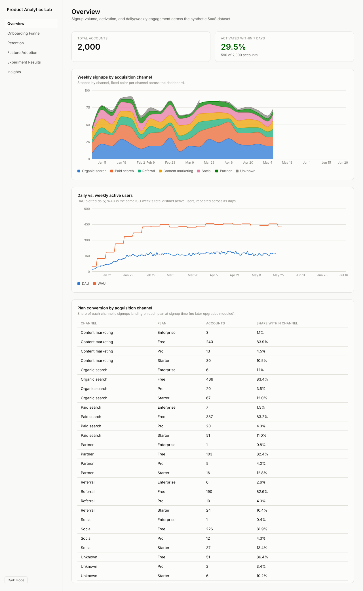
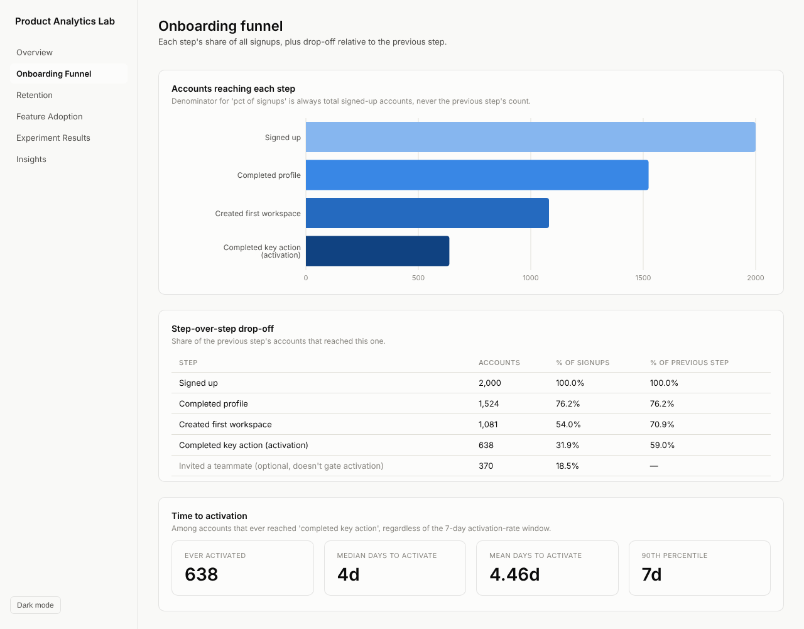
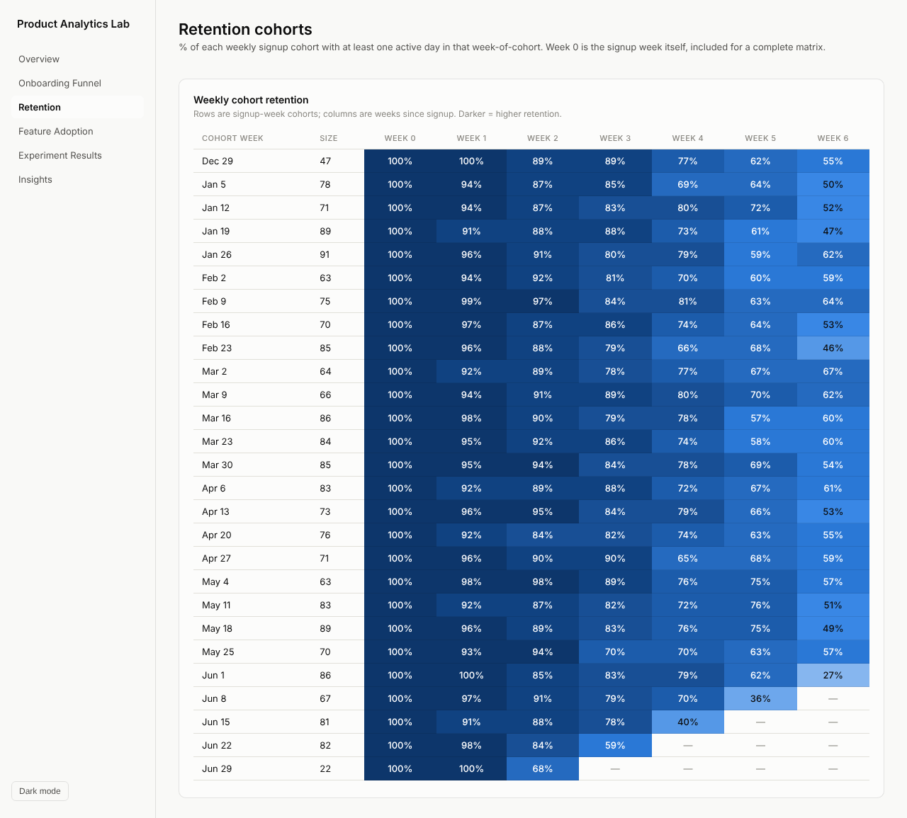
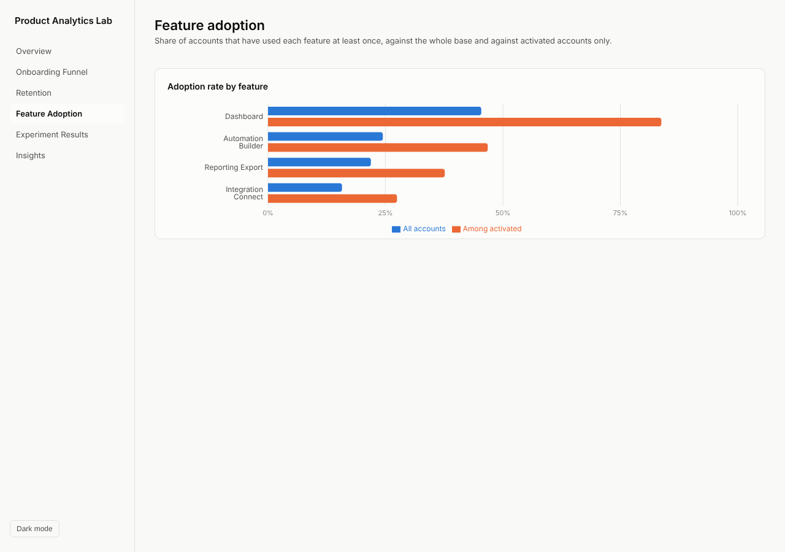
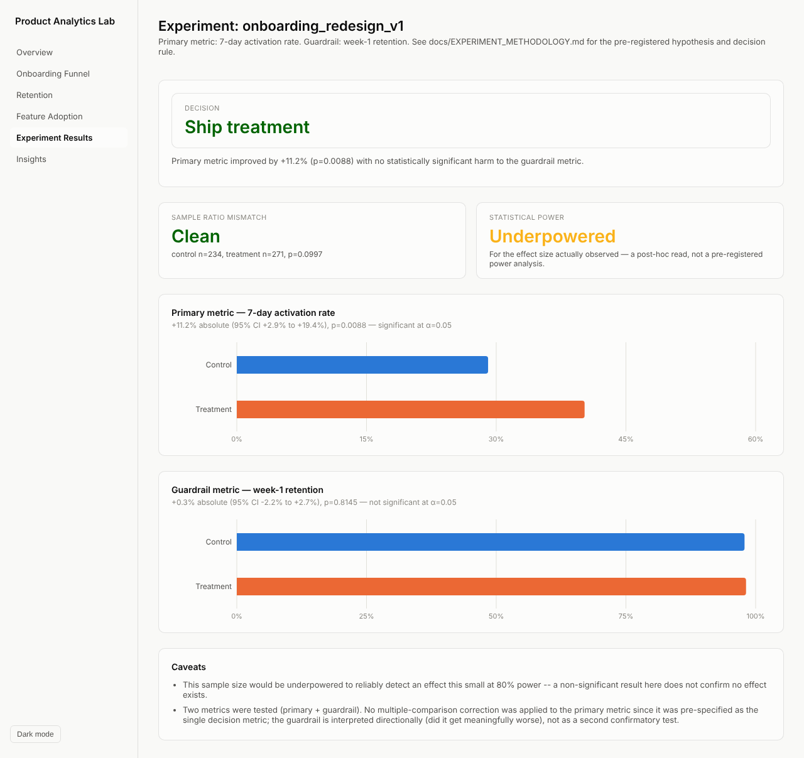
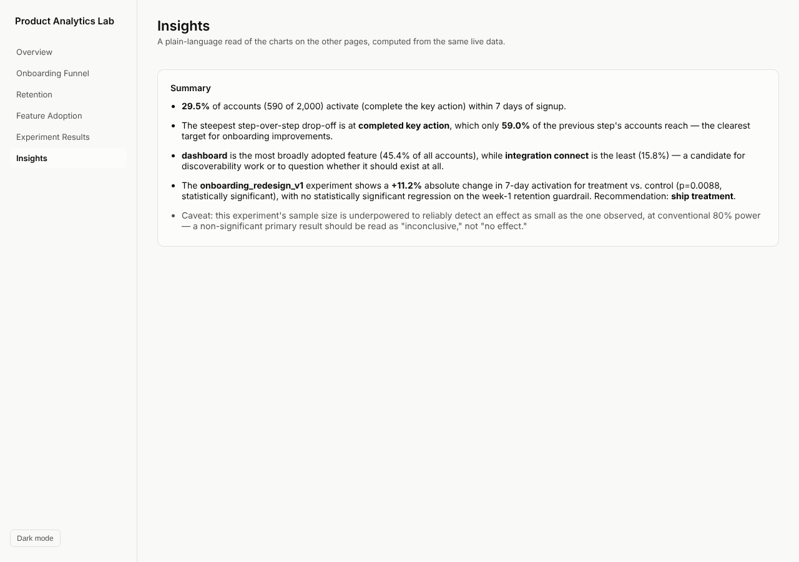

# Product Analytics & Experimentation Lab

A self-contained product analytics stack: a deterministic synthetic SaaS
dataset, a DuckDB analytics layer, an A/B experimentation engine, a FastAPI
read-only API, and a React + TypeScript dashboard — built to demonstrate the
same end-to-end rigor (reproducible data, tested metric definitions,
honestly-caveated statistics) as a real product analytics team's tooling.

**All data is synthetic**, generated deterministically from a fixed seed.
No real user data is used anywhere — see `docs/DATA_DICTIONARY.md`.

Read `docs/CASE_STUDY.md` for the portfolio write-up, including what the
generated data actually shows.

## Architecture

```
generator/generate.py  →  generator/data/raw/*.csv  →  db/load.py  →  db/analytics.duckdb
                                                                            │
                                                     db/metrics.py, db/experiment.py
                                                                            │
                                                          api/app  (FastAPI, read-only)
                                                                            │
                                                              web/  (React + TS + Vite)
```

- **`generator/`** — deterministic synthetic data generation (NumPy seeded
  `Generator`, no `uuid4()` or other unseeded randomness anywhere in the
  pipeline). Re-running it with the same `SEED` produces byte-identical CSVs.
- **`db/`** — DuckDB schema (`sql/001_schema.sql`), canonical deduplicated
  views (`sql/002_views.sql`), the load script, and the two Python modules
  (`metrics.py`, `experiment.py`) that are the **single source of truth**
  for every number the API and dashboard show.
- **`api/`** — FastAPI app. Every route is a thin wrapper over `db/metrics.py`
  / `db/experiment.py`; it holds no analysis logic of its own.
- **`web/`** — React + TypeScript + Vite dashboard (Recharts), light/dark
  themes, a validated colorblind-safe palette.

## Setup

Requires Python 3.11+ and Node 20+.

```bash
# 1. Generate the synthetic dataset (reproducible, ~2,000 accounts)
cd generator && pip install -r requirements.txt
python generate.py

# 2. Build the DuckDB database from the generated CSVs (uses the same deps from step 1)
cd ../db
python load.py

# 3. Run the API
cd ../api && pip install -r requirements.txt
uvicorn app.main:app --reload --port 8000

# 4. Run the dashboard (in a separate terminal)
cd ../web && npm install
npm run dev
```

The dashboard expects the API at `http://localhost:8000` by default
(`web/.env` → `VITE_API_BASE_URL`).

## Tests

```bash
# Generator, metrics, and experiment engine (32 tests)
cd /path/to/product-analytics-lab && pip install -r generator/requirements.txt
python -m pytest tests/ -v

# API (17 tests — requires the database built per step 2 above)
cd api && python -m pytest tests/ -v

# Frontend (28 tests)
cd web && npm run test
```

## Dashboard

| Overview | Onboarding funnel |
|---|---|
|  |  |

| Retention cohorts | Feature adoption |
|---|---|
|  |  |

| Experiment results | Insights |
|---|---|
|  |  |

## Documentation

- [`docs/DATA_DICTIONARY.md`](docs/DATA_DICTIONARY.md) — tables, views, and
  the intentional data-quality issues baked into the raw data
- [`docs/EVENT_TAXONOMY.md`](docs/EVENT_TAXONOMY.md) — every event name the
  generator emits
- [`docs/METRIC_DEFINITIONS.md`](docs/METRIC_DEFINITIONS.md) — the prose
  definition of every metric in `db/metrics.py`
- [`docs/EXPERIMENT_METHODOLOGY.md`](docs/EXPERIMENT_METHODOLOGY.md) — the
  pre-registered hypothesis, metrics, and decision rule for the
  `onboarding_redesign_v1` experiment
- [`docs/CASE_STUDY.md`](docs/CASE_STUDY.md) — portfolio write-up with live
  results from the generated data

## Tech stack

Python (NumPy, pandas, DuckDB, SciPy, FastAPI, pytest) · TypeScript (React,
Vite, Recharts, Vitest, React Testing Library)
